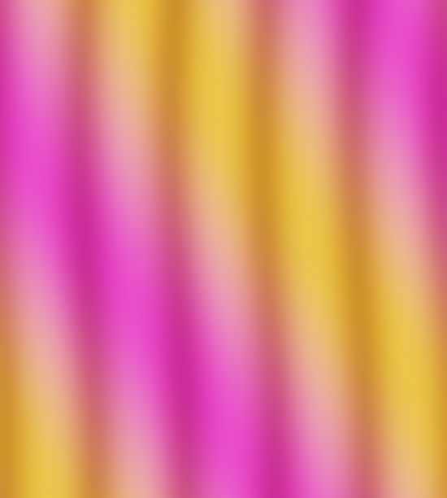
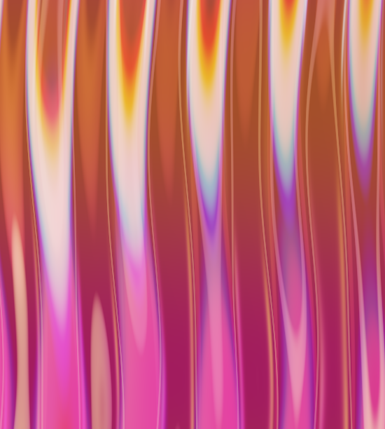
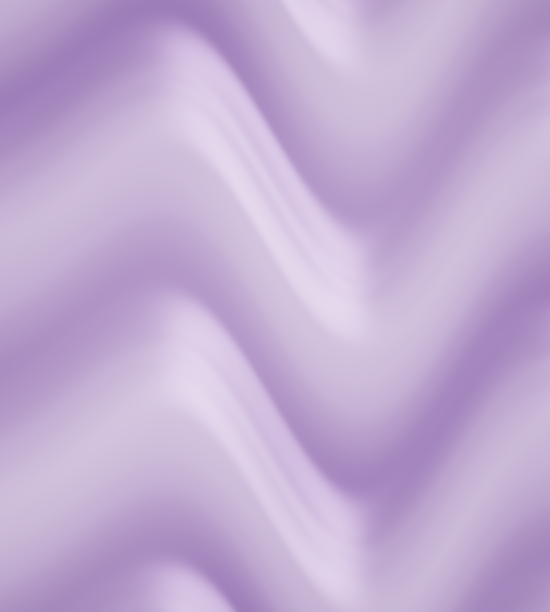
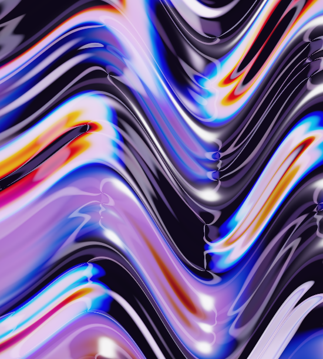
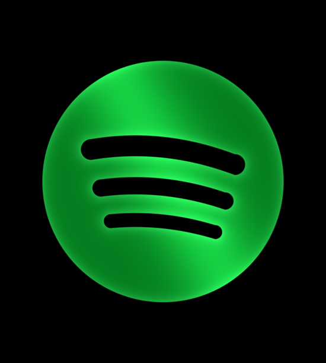
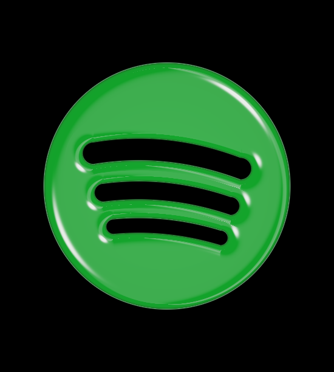
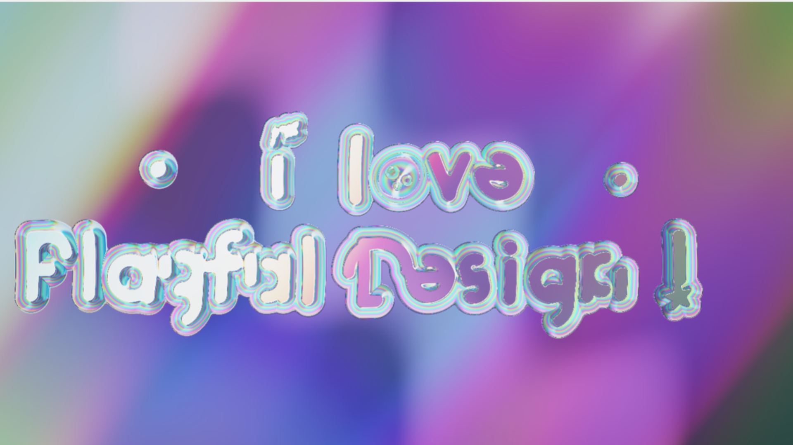
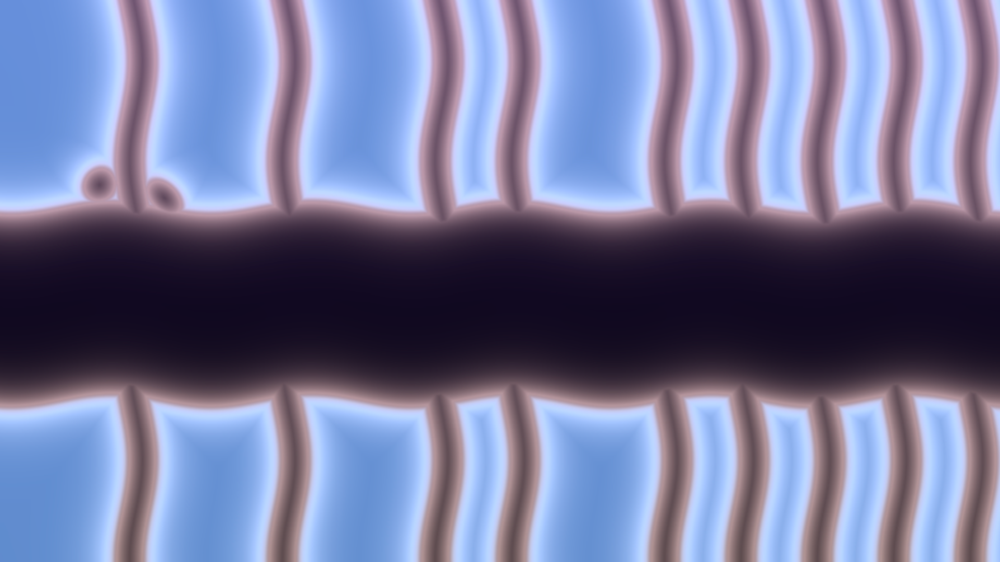
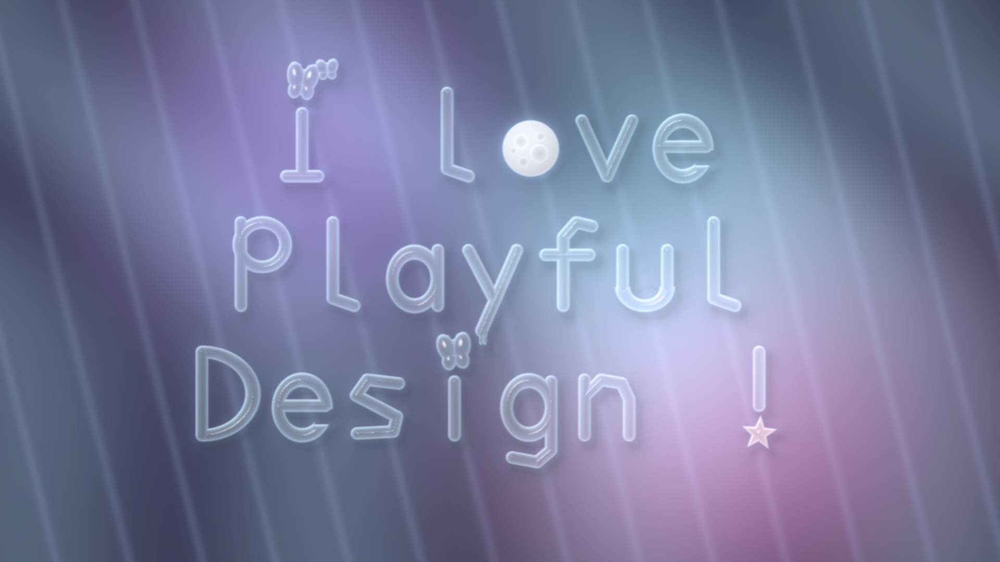
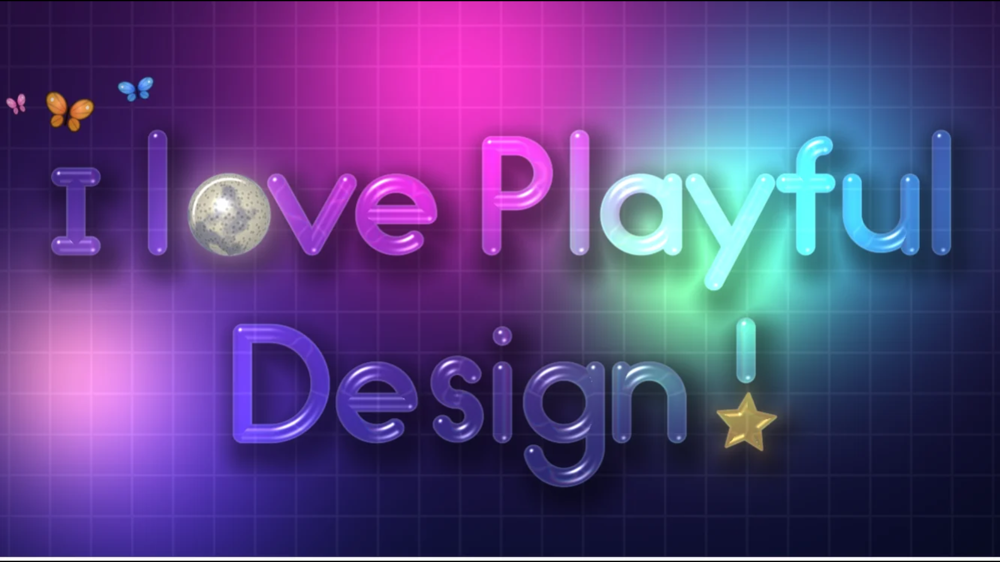

# Shader Liquid Glass

A set of Agent Skills for Claude Code that create **liquid glass** in GLSL shaders: animated backgrounds, UI, words or shapes (hearts, stars, butterflies…).

## Install

```sh
npx skills add Playful-Design/liquid-glass-skill
```

Install the full collection so the `liquid-glass-skill` entry skill can route to the background, typography, shape, glassmorphism, and material skills. The repository owner is `Playful-Design`.

Everything can run from one command:

```
/shader-liquid-glass 'i love Playful!' letter i shape heart letter ! shape sparkle vibe dripping background lilac
```

## Before and after examples

Prompt: “Animate vertical glass ribs in pink and orange, with soft reflections and prismatic edges”

| Before · no skill | After · with skill |
| --- | --- |
|  |  |
| [Animated HTML](examples/comparisons/ribs-before.html) · [GLSL](examples/comparisons/ribs-before.glsl) | [Animated HTML](examples/comparisons/ribs-after.html) · [GLSL](examples/comparisons/ribs-after.glsl) |

Prompt: “Create slowly moving violet liquid glass with deep glossy folds and pale lavender reflections”

| Before · no skill | After · with skill |
| --- | --- |
|  |  |
| [Animated HTML](examples/comparisons/violet-before.html) · [GLSL](examples/comparisons/violet-before.glsl) | [Animated HTML](examples/comparisons/violet-after.html) · [GLSL](examples/comparisons/violet-after.glsl) |

Prompt: “Create a slowly moving liquid glass Spotify logo with polished green glass and refractive edges on a dark background”

| Before · no skill | After · with skill |
| --- | --- |
|  |  |
| [Animated HTML](examples/comparisons/spotify-before.html) · [GLSL](examples/comparisons/spotify-before.glsl) | [Animated HTML](examples/comparisons/spotify-after.html) · [GLSL](examples/comparisons/spotify-after.glsl) |

---

## Why these skills exist

### What AI models struggle with

Frontier Models tend to have the same problems:

- **Incorrect texture.** Without a precise description of glass optics, models produce a flat transparent tint, a generic blur, or a uniform gradient. It often misses light bending through material, iridescent film on the surface, highlights that move etc.
- **Lettering.** When models build letters with graphics, they rebuild them from simple lines or forms, often leading artifacts of overlap or isolated effects that don't share a material or light source. Additionally, if you want to change the dot of an *i*, *j* or *!* with a shape, the agents have difficulty identifying the size and placement. We supported this for graphic design playfulness. 
- **Light rays.** We added some physics details to produce sharp and diffused light sources more accurately. 

<!-- IMAGE: comparison — the same request ("I love Playful Design!", star on the i, heart on the !) made by other models without the skills -->
### Without skills : 

| Argon 4 | Deepseek | GPT 6.1 Sol | Claude Opus 5 |
|---|---|---|---|
|  |  |  |  |

### Why use a skill?

Models still struggle with 3D physics and software for design: modeling each letter, setting up glass materials, lighting, refraction, then animating the liquid. 

Describe the text, shapes and mood in one sentence. The skill handles the glass, lighting and motion, and gives you an animated shader ready to play in your browser.

---

## What you can make

| Use | What you get |
|---|---|
| **Backgrounds** | The animated liquid glass surface, full screen: for a website, an app, a presentation or a video background. |
| **Typography** | Words, names, titles or sentences carved into liquid glass, in any font, with shapes in place of the dots. |
| **UI design** | Glass titles, labels and hero visuals for interfaces, on a solid color or on your own mock-up or photo. Each design comes with a live `.html` page you can open, present or record. |

<!-- IMAGE: one example per use: background, typography, UI (e.g. text on a photo or mock-up) -->

---

## How it works

### 1. One command, two modes

`/shader-liquid-glass` reads your request and picks the mode:

- **No text** → the **liquid glass background** (`/shader-liquid-glass`, or "make a liquid glass shader").
- **Text** → **liquid glass lettering** (`/shader-liquid-glass 'butterfly'`, or "write butterfly in liquid glass").

```sh
/shader-liquid-glass 'butterfly' font "DM Serif Display" background black
```

[Butterfly lettering HTML](examples/lettering/butterfly.html) · [GLSL](examples/lettering/butterfly.glsl)


### 2. Real fonts

The letters come from real fonts, not from shapes drawn by the model. A script reads the font file and turns each letter's exact outline into shader math, keeping the font's own spacing and kerning.

- Any **Google Fonts** family, by name: `font Pacifico`
- Your own font file: `font ~/fonts/Brand.otf`
- Weights and styles: `bold`, `italic`, `weight 800`

### 3. Vibes

Instead of picking a font, describe a mood. Each vibe picks a font, plus the settings that make it look good in glass, and a matching background color:

| Vibe | Also understood as | Font |
|---|---|---|
| `cloud` | fluffy, soft, bubbly | Rubik Bubbles |
| `romantic` | valentine, love, wedding | Lavishly Yours |
| `cartoon` | storybook, old design, whimsical | Henny Penny |
| `dripping` | wet paint, melting, spooky | Rubik Wet Paint |
| `adventure` | bold, adventurous | Caprasimo |
| `medieval` | fantasy, celtic | Uncial Antiqua |

```
/shader-liquid-glass 'Be mine' letter i shape heart bigger vibe valentine
```

Vibes live in one small file (`glsl-sdf-typography/vibes.json`), so you can add your own.

<!-- IMAGE: the same text in several vibes -->

### 4. Shapes instead of dots

The script finds the dot of each *i*, *j*, *!* or *?* (or an accent) in the font itself, removes it, and puts the shape exactly in its place and at the right size. If the shape is enlarged, it moves away from the letter so it never touches it.

- **Replace a dot:** `letter i shape heart`
- **Replace a whole letter:** `letter o shape fullmoon whole` (a full moon instead of the o)
- **Pick which one:** `letter i in Design`, `letter i second`
- **Size:** `small`, `big`, `bigger`

**15 shapes:** circle, heart, star, sparkle, diamond, moon, full moon, flower, plus, butterfly, butterflies, cloud, crown, spade ♠, club ♣.

<!-- IMAGE: previews/shapes-catalogue.png and previews/new-shapes-glass.png -->

### 5. Carved into the glass, not one effect per letter

This is the key difference. Applying the glass effect **to each letter separately** looks cheap: every letter catches its own highlights and its own colors, and the text looks like foil balloons.

Instead, the text is **carved into one continuous liquid glass surface**, the same surface as the background mode. The liquid flows from one letter to the next as **one material**, and each letter's outline is a soft rounded glass edge that catches the light.

<!-- IMAGE: before / after — previews/1-current.png (one effect per letter) vs previews/7-surface-pastel-rich.png (carved into the glass) -->

You can tune the material:

- **Rainbow** (default on dark backgrounds): the original deep, iridescent liquid glass colors.
- **Pastel** (default on light backgrounds and images): soft, pearly glass.
- **`rainbow`** / **`pastel`**: forces one or the other.
- **`tint pink`**, **`tint white`**…: changes the hue of the pastel glass.
- **`3d`**: the older look, with each letter as a separate puffy object, if you really want it.

### 6. Backgrounds: solid color or your own image

- **`background lilac`**, **`background #F2EEE6`**: one solid color, so the text stays readable.
- **`image photo.jpg`**: the text sits on your picture, casts a soft shadow on it, and the glass bends it. iPhone photos (HEIC) are converted automatically.

<!-- IMAGE: text on a photo -->

### 7. Watch it live

Each design produces two files:

- **`name.glsl`**: the shader, ready for Shadertoy or your own project.
- **`name.html`**: double-click it to watch the animation live in any browser. **Space** pauses, **S** saves a PNG, and you can drop another image onto it.

The text stays still and only the liquid moves, so the page computes the letters once and then animates smoothly.

### 8. Finishes

The glass appearance skills adjust any liquid glass shader: `/frost`, `/polished`, `/smooth`, `/textured`, `/translucent`, `/transparent`.

---

## Glassmorphism vs liquid glass

The two are often confused, but they are different ideas.

| | **Glassmorphism** | **Liquid glass** |
|---|---|---|
| **What it is** | A flat UI style: semi-transparent panels with a blurred background | A physical material: thick glass that behaves like real glass and liquid |
| **How it's made** | 2D: transparency, background blur, a thin light border (e.g. CSS `backdrop-filter`) | Light simulation: refraction (light bends through the glass), color separation at the edges (prism effect), reflections that depend on the angle, absorption in thick areas, an iridescent film like a soap bubble |
| **What's behind it** | Blurred, but not distorted | Bent and magnified by the thickness of the glass |
| **Edges** | A thin outline | Rounded edges that catch the light |
| **Movement** | Static | The surface flows like a viscous liquid, and highlights move across it |
| **Feeling** | Frosted window | Drop of water, molten glass, jewel |

In short, **glassmorphism imitates frosted glass with blur. Liquid glass simulates how light travels through a thick, moving glass material.** That optical behavior is what these skills write into the shader.

<!-- IMAGE: glassmorphism example vs liquid glass example -->

---

## The skills

| Skill | Role |
|---|---|
| [`shader-liquid-glass`](./shader-liquid-glass/SKILL.md) | The `/shader-liquid-glass` command: reads your request and picks the mode |
| [`glsl-liquid-glass`](./glsl-liquid-glass/) | The liquid glass background: the optical recipe (Fresnel, dispersion, absorption, iridescence, lighting) |
| [`glsl-sdf-typography`](./glsl-sdf-typography/SKILL.md) | The lettering: font script, vibes, carved-glass and 3D looks, image backgrounds, live preview page |
| [`glsl-sdf-shapes`](./glsl-sdf-shapes/SKILL.md) | The library of shapes that replace dots and letters |
| [`glsl-glass-appearance`](./glsl-glass-appearance/) | The finishes: frost, polished, smooth, textured, translucent, transparent |

## Installation

Copy the skill folders into `~/.claude/skills/` (every project) or `.claude/skills/` (one project):

```bash
for s in shader-liquid-glass glsl-liquid-glass glsl-sdf-typography glsl-sdf-shapes; do
  cp -R "$s" ~/.claude/skills/
done
cp -R glsl-glass-appearance/* ~/.claude/skills/
```

The lettering script needs Python 3 and fontTools:

```bash
pip install fonttools
```

Fonts are downloaded from Google Fonts the first time you use them, then cached.

## Examples

```
/shader-liquid-glass
/shader-liquid-glass 'Mia' letter i shape heart background pink
/shader-liquid-glass 'happy birthday' letter i in birthday shape star vibe cloud background light blue
/shader-liquid-glass 'I love / playful Design !' letter o shape fullmoon whole letter i shape butterfly bigger letter ! shape star vibe adventure background lilac tint pink
/shader-liquid-glass 'Summer!' letter ! shape heart vibe cloud image ~/Pictures/beach.jpg
```

## Good to know

- **Fonts and licences:** Google Fonts can be embedded freely (OFL or Apache licences). If you use your own font file, check that its licence allows embedding, because the shader contains the letter outlines.
- **Very detailed fonts** (textures, splatters) make heavy shaders. The script warns you and can simplify them.
- **Shapes on light backgrounds:** small, detailed shapes like `butterflies` can be hard to see on white. Use `bigger`, or a colored background.

## License

Playful Design’s Liquid Glass skills are open source under the [MIT License](LICENSE).
